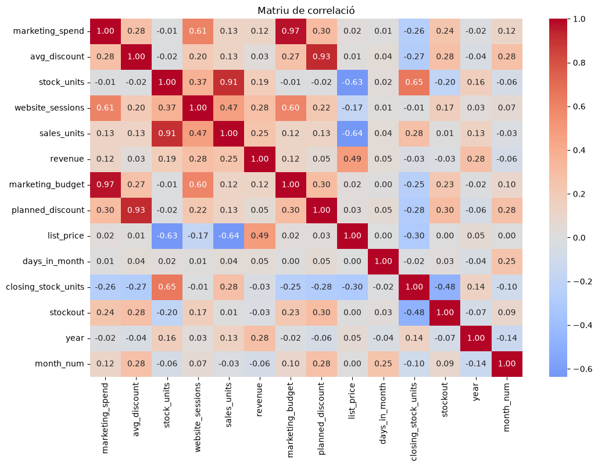

# Memòria del projecte BiciTierraMarket
## Índex

- [Memòria del projecte BiciTierraMarket](#memòria-del-projecte-bicitierrmarket)
    + [Índex](#índex)
    + [Introducció](#introducció)
    + [Tecnologies](#tecnologies)
        * [Python](#python)
        * [Pandas i NumPy](#pandas-i-numpy)
        * [Scikit-learn](#scikit-learn)
        * [Jupyter Notebook](#jupyter-notebook)
    + [Anàlisi de les possibles solucions](#anàlisi-de-les-possibles-solucions)
        * [Regressió vs Classificació](#regressió-vs-classificació)
            - [Avantatges](#avantatges)
            - [Desavantatges](#desavantatges)
        * [Segmentació per regles vs Clustering (K-Means)](#segmentació-per-regles-vs-clustering-k-means)
            - [Avantatges](#avantatges-1)
            - [Desavantatges](#desavantatges-1)
        * [Opinió del grup](#opinió-del-grup)
    + [Requisits del sistema](#requisits-del-sistema)
        * [Requisits funcionals](#requisits-funcionals)
        * [Requisits no funcionals](#requisits-no-funcionals)
    + [Arquitectura del sistema i flux de dades](#arquitectura-del-sistema-i-flux-de-dades)
        * [Orígens de dades -> Preprocessament i Qualitat](#orígens-de-dades---preprocessament-i-qualitat)
        * [Preprocessament -> Modelatge predictiu i Segmentació](#preprocessament---modelatge-predictiu-i-segmentació)
    + [Desenvolupament de la solució](#desenvolupament-de-la-solució)
        * [Consideracions prèvies i reproduïbilitat](#consideracions-prèvies-i-reproduïbilitat)
        * [Configuració del projecte i posada en marxa](#configuració-del-projecte-i-posada-en-marxa)
            - [Execució seqüencial dels notebooks](#execució-seqüencial-dels-notebooks)
    + [Funcionament i resultats del projecte](#funcionament-i-resultats-del-projecte)
        * [Bloc 1: Plantejament del problema i exploració](#bloc-1-plantejament-del-problema-i-exploració)
            - [Predictors inicials i hipòtesis](#predictors-inicials-i-hipòtesis)
            - [Proves exploratòries de models](#proves-exploratòries-de-models)
        * [Bloc 2: Preparació reproduïble i modelatge de referència](#bloc-2-preparació-reproduïble-i-modelatge-de-referència)
            - [Decisions de qualitat de dades](#decisions-de-qualitat-de-dades)
            - [Selecció de predictors i prevenció de fuga de dades](#selecció-de-predictors-i-prevenció-de-fuga-de-dades)
            - [Referències (Baselines) i validació temporal](#referències-baselines-i-validació-temporal)
        * [Bloc 3: Segmentació de clients](#bloc-3-segmentació-de-clients)
            - [Qualitat de les dades de clients](#qualitat-de-les-dades-de-clients)
            - [Variables del clustering i K-Means](#variables-del-clustering-i-k-means)
            - [Perfils obtinguts](#perfils-obtinguts)
            - [Accions comercials per perfil](#accions-comercials-per-perfil)
    + [Dificultats i futures millores](#dificultats-i-futures-millores)
        * [Dificultats](#dificultats)
        * [Futures millores](#futures-millores)
    + [Conclusió](#conclusió)
    + [Bibliografia](#bibliografia)


## Introducció
**BiciTierraMarket** és un projecte d'anàlisi de dades i aprenentatge automàtic (*Machine Learning*) orientat a optimitzar l'estratègia comercial i la gestió d'estocs d'una empresa de venda de bicicletes.

El projecte respon a la pregunta principal de negoci: **què fa que venguem més unitats: el màrqueting, els descomptes o altres factors?** Per donar-hi resposta, la solució es divideix en doss grans línies de treball:

- **Predicció de vendes (`sales_units`):** Desenvolupament d'un flux de treball reproduïble per predir la demanda mensual per canal, línia de producte i regió, establint llistons de referència (*baselines*) i evitant la fuga de dades (*data leakage*).
- **Segmentació de clients:** Identificació de perfils de compra mitjançant tècniques de *clustering* sobre la base de clients (`customers.csv`) per dissenyar campanyes personalitzades, serveis i prioritats comercials.

## Tecnologies
### Python
Python és el llenguatge de programació principal utilitzat en tot el projecte per la seua versatilitat, sintaxi clara i el seu ampli ecosistema de llibreries orientades a la ciència de dades i la intel·ligència artificial.

### Pandas i NumPy
Hem emprat **Pandas** i **NumPy** per a la càrrega, manipulació, neteja i transformació dels conjunts de dades tabulars (`sales_history.csv`, `customers.csv` i `sales_forecast_input.csv`), així com per al càlcul de retards temporals (*lags*) i imputacions de valors nuls.

### Scikit-learn
**Scikit-learn** ha estat el marc de treball utilitzat per implementar els algorismes d'aprenentatge supervisat (regressió lineal, polinomial, logística i *Gradient Boosting*) i no supervisat (*K-Means*), així com les eines d'escalat de variables (`StandardScaler`) i mètriques d'avaluació (R2, MAE, WAPE i *Silhouette*).

### Jupyter Notebook
Hem utilitzat **Jupyter Notebook** com a entorn de desenvolupament interactiu per documentar el procés analític pas a pas, combinar codi executable amb explicacions en `Markdown` i generar visualitzacions exploratòries (com la matriu de correlació i histogrames).

## Anàlisi de les possibles solucions

En aquest apartat analitzem els diferents enfocaments metodològics i algorítmics avaluats per resoldre tant la predicció de vendes com la segmentació de clients, justificant per què n'hem seleccionat uns i n'hem descartat d'altres.

### Regressió vs Classificació

Primerament, comparem les dos aproximacions avaluades per predir el volum de vendes (`sales_units`):

- **Models de Regressió** (Lineal, Polinomial de grau 2 i 3, Gradient Boosting)
- **Models de Classificació** (Regressió logística dividint les vendes en trams: baix, mitjà i alt)

#### Avantatges

| Avantatges Regressió | Avantatges Classificació |
|:---|:---|
| Prediu la quantitat exacta d'unitats a vendre | Fàcil interpretació per categories (baix/mitjà/alt) |
| Permet acotar físicament entre 0 i `stock_units` | Útil si sols és cal activar amb alertes d'estoc |
| Mètriques directes de negoci (MAE en bicicletes) | Menys sensible a petites variacions numèriques |
| Alta precisió en proves exploratòries ($R^2 \approx 0,90 - 0,92$) | *Accuracy* global acceptable ($\approx 0,80$) |

#### Desavantatges

| Desavantatges Regressió | Desavantatges Classificació |
|:---|:---|
| Risc de sobreajustament (*overfitting*) en graus polinomials alts (grau 3) | Pèrdua de granularitat per calcular compres d'estoc |
| Sensible a valors extrems si no es tracten bé els nuls | Molta confusió en els casos de frontera (només 67 % d'encert en vendes mitjanes) |

### Segmentació per regles vs Clustering (K-Means)

Seguidament, comparem les estratègies per agrupar els 2.000 clients de la companyia:

- **Segmentació per regles heurístiques** (devolucions altes, inactius, valuosos, resta)
- **Clustering no supervisat (K-Means)**

#### Avantatges

| Avantatges Regles simples | Avantatges K-Means |
|:---|:---|
| Molt fàcil d'explicar a un tercer no tècnic | Descobreix patrons ocults en múltiples dimensions |
| Determinista i immediat d'aplicar | Separa bé els clients de tiquet molt alt dels de freqüència alta |
| Detecta ràpidament els extrems evidents | Permet ajustar la granularitat ($k=5$ perfils accionables) |

#### Desavantatges

| Desavantatges Regles simples | Desavantatges K-Means |
|:---|:---|
| Deixa un grup `Resta` massa gran i heterogeni | Requereix escalat previ i transformació logarítmica (`log`) |
| Barreja comportaments comercials molt diferents | Separació moderada (*Silhouette* $\approx 0,34$, amb un 3 % de clients fronterers) |

### Opinió del grup

En el nostre equip hem acordat adoptar les següents estratègies:

- **Per a la predicció de vendes:** Descartem la classificació pels errors en les fronteres de decisió i treballem exclusivament amb **regressió**, utilitzant la regressió lineal com a base interpretable i models no lineals (polinomial de grau 2 i *Gradient Boosting*) com a alternatives, avaluant-los amb **MAE** i **WAPE** (i $R^2$ en exploració).
- **Per a la segmentació:** Seleccionem **K-Means amb $k = 5$**, ja que aporta molt més detall operatiu que les regles manuals, permetent distingir dos palanques clau de negoci: volum de compres (*Fidels freqüents*) front a import per compra (*Tiquet alt*).

## Requisits del sistema

Aquest apartat detalla les capacitats funcionals i les restriccions tècniques i de negoci que regeixen el projecte.

### Requisits funcionals

- **Neteja i imputació contextualitzada:** Tractar els valors nuls segons la lògica de negoci de cada variable sense distorsionar les distribucions.
- **Prevenció de fuga de dades (*Data Leakage*):** Garantir que els models predictius només utilitzin variables conegudes abans de l'inici del mes a predir.
- **Càlcul de referències (*Baselines*):** Establir un llistó mínim de rendiment basat en la mitjana històrica i en el mateix mes de l'any anterior (`lag_12`).
- **Segmentació de clients:** Classificar la cartera de clients en perfils diferenciats i associar-hi accions comercials mesurables.

### Requisits no funcionals

- **Reproduïbilitat estricta:** L'execució seqüencial del codi amb una llavor fixa (`seed`) ha de produir exactament els mateixos resultats.
- **Integritat de les dades originals:** Mai s'han de sobreescriure els fitxers CSV d'entrada (`sales_history.csv`, `customers.csv`); tots els canvis es guarden en fitxers derivats.
- **Restricció física de negoci:** Totes les prediccions de vendes s'han d'acotar obligatòriament dins l'interval [0, stock_units], ja que és físicament impossible vendre per sobre de l'estoc disponible.

## Arquitectura del sistema i flux de dades

El sistema segueix una arquitectura de *pipeline* analític modular estructurat en *notebooks* independents que transformen les dades crues en coneixement accionable, mantenint una separació estricta entre les fases de neteja, validació temporal i modelatge.

### Orígens de dades -> Preprocessament i Qualitat

El flux parteix de tres fitxers CSV principals:
1. `sales_history.csv`: 1.188 registres històrics i 17 columnes de vendes mensuals.
2. `sales_forecast_input.csv`: estructura de variables planificades disponibles a inici de mes.
3. `customers.csv`: fotografia de 2.000 clients a data 30/06/2026 (una fila per client).

Durant aquesta primera etapa (documentada a `customers.ipynb`, `clean_saleshistory.ipynb` i `prova_visualitzacions.ipynb`), s'apliquen regles d'imputació i es generen fitxers derivats (com `out.csv`) per preservar la traçabilitat.

```python
# Exemple conceptual del tractament contextualitzat de nuls i restricció física
df_sales["avg_discount"] = df_sales["avg_discount"].fillna(0)
df_sales["marketing_spend"] = df_sales["marketing_spend"].fillna(df_sales["marketing_spend"].mean())

# Acotació física de les prediccions entre 0 i l'estoc inicial disponible
prediccions_acotades = np.clip(prediccions, 0, df_validacio["stock_units"])
```

### Preprocessament -> Modelatge predictiu i Segmentació

Una vegada que les dades estan netes, es divideixen en dos branques:
- **Branca Predictiva:** S'aplica una partició temporal estricta (entrenament 2022–2024, validació 2025, reserva de prova 2026) i es calculen retards dins de cada sèrie (`lag_1`, `lag_12`) sense creuar grups.
- **Branca de Segmentació (`cp3.ipynb`):** Se seleccionen 4 variables de comportament, s'aplica transformació logarítmica sobre el tiquet mitjà i s'estandarditzen les escales (mitjana $0$, desviació $1$) abans d'executar K-Means.

## Desenvolupament de la solució

### Consideracions prèvies i reproduïbilitat

Per garantir que qualsevol execució del procés analític done exactament els mateixos resultats, s'han imposat tres normes de desenvolupament:

- **Ordre seqüencial estricta:** Les cel·les dels *notebooks* s'han d'executar de dalt a baix sense salts per evitar errors d'estat o variables no definides.
- **Preservació dels fitxers originals:** Mai es modifiquen els CSV originals, les transformacions s'exporten a fitxers derivats.
- **Llavor fixa (`seed`):** Es fixa una llavor aleatòria constant perquè les particions i les inicialitzacions de K-Means siguin sempre idèntiques.

### Configuració del projecte i posada en marxa

> **Nota sobre l'entorn:** El projecte està dissenyat per executar-se en un entorn Python 3 amb Jupyter Notebook (o VS Code amb l'extensió de Jupyter) i les llibreries estàndard de ciència de dades instal·lades (`pandas`, `numpy`, `scikit-learn`, `matplotlib`/`seaborn`).

#### Execució seqüencial dels notebooks

Per reproduir l'estudi complet des de zero, cal executar els quaderns en l'ordre lògic del flux de dades:

1. **Neteja i exploració inicial:**
   - `clean_saleshistory.ipynb` (tractament de l'històric de vendes).
   - `customers.ipynb` (revisió de la base de clients).
   - `prova_visualitzacions.ipynb` (evidències gràfiques i comprovació d'imputacions).
2. **Segmentació i lliurables:**
   - `cp3.ipynb` (execució del clustering K-Means, anàlisi de *silhouette* i simulació d'accions comercials).
   - `memoria.ipynb` (síntesi executiva i resultats consolidats).

## Funcionament i resultats del projecte

A continuació es detallen els resultats obtinguts en cadascun dels tres blocs principals que componen la memòria tècnica de **BiciTierraMarket**.

### Bloc 1: Plantejament del problema i exploració

L'anàlisi inicial es centra en `sales_history.csv` (1.188 registres), prenent `sales_units` com a variable objectiu i `marketing_spend` i `avg_discount` com a predictors principals.

<p align="center">
    
</p>
<p align="center"><em>Fig 1: Matriu de correlació de les variables inicials respecte a les vendes</em></p>

#### Predictors inicials i hipòtesis

Per aïllar l'efecte real del màrqueting i del descompte **a igualtat de canal, línia de producte, regió i mes**, es formulen quatre hipòtesis de treball:

| Codi | Hipòtesi | Com es comprova |
|:---|:---|:---|
| **H0** | Les vendes depenen sobretot del canal, la línia, la regió i el mes. | Correlació aproximadament 0,85 amb la mitjana per grup. |
| **H1** | Més màrqueting -> més vendes, però cada vegada guanyem menys. | Regressió polinomial: es refuta si la corba és recta o plana. |
| **H2** | Més descompte -> més vendes, amb efecte limitat. | Lineal + polinomial: es refuta si el coeficient és negatiu o no significatiu. |
| **H3** | El màrqueting actua sobretot a través de les visites web (*e-commerce*). | Lineal amb i sense `website_sessions`: es refuta si el coeficient no canvia. |

#### Proves exploratòries de models

Es van realitzar proves preliminars amb diferents algorismes sobre el conjunt de dades:

| Model | Resultat orientatiu | Observacions |
|:---|:---|:---|
| Regressió lineal | $R^2 \approx 0,90$ · $\text{MAE} \approx 11\text{ u.}$ | Base sòlida i fàcil d'interpretar. |
| **Regressió polinomial (grau 2)** | **$R^2 \approx 0,92$ · $\text{MAE} \approx 10\text{ u.}$** | Millora lleugerament la lineal; el grau 3 sobreajusta ($R^2$ test cau a $0,83$). |
| Regressió logística (baix/mitjà/alt) | $\text{Accuracy} \approx 0,80$ | Descartada: només un $67\%$ d'encert en vendes mitjanes. |
| Gradient Boosting | $R^2 \approx 0,79$ · $\text{MAE} \approx 16\text{ u.}$ | Alternativa no lineal per a fases posteriors. |

### Bloc 2: Preparació reproduïble i modelatge de referència

#### Decisions de qualitat de dades

Abans d'entrenar cap model definitiu, s'aplica un protocol estricte d'imputació de valors nuls:

| Fitxer | Variable | Tractament dels nuls | Motiu |
|:---|:---|:---|:---|
| `sales_history.csv` | `marketing_spend`, `marketing_budget` | **Mitjana** | L'empresa manté una inversió recurrent; un `0` distorsionaria la realitat. |
| `sales_history.csv` | `website_sessions` | **Mitjana** | Sempre hi ha trànsit web mensual, especialment al canal *ecommerce*. |
| `sales_history.csv` | `avg_discount`, `planned_discount` | **`0`** | Un valor buit indica venda a preu complet (sense descompte). |
| `customers.csv` | `age` | **Mitjana** | Un client comprador no pot tindre 0 anys, així es manté la coherència demogràfica. |
| `customers.csv` | `annual_spend`, `days_since_last_order` | **`0`** (en revisió inicial) | Interpretat inicialment com a absència de compra o compra el mateix dia (refinat a la fase 3). |

> **Risc de mala imputació:** Posar `0` en lloc de la mitjana a `sales_units` crearia valors extrems artificials (*outliers*), ja que cap sèrie baixa mai a zero vendes, empitjorant el MAE, l'MSE i el R2.

#### Selecció de predictors i prevenció de fuga de dades

Per evitar el *data leakage*, només s'admeteixen variables conegudes **abans que comenci el mes** a predir (com a `sales_forecast_input.csv`):

| Variable | Estat | Motiu |
|:---|:---|:---|
| `month`, `days_in_month` | **Admesa** | Dades de calendari que capturen l'estacionalitat. |
| `channel`, `product_line`, `region` | **Admesa** | Identifiquen cadascuna de les sèries temporals. |
| `stock_units`, `list_price` | **Admesa** | Estoc inicial (límit superior de vendes) i preu de catàleg coneguts a inici de mes. |
| `marketing_budget`, `planned_discount`, `campaign` | **Admesa** | Decisions comercials planificades prèviament. |
| `lag_1`, `lag_12` (i altres retards) | **Admesa (derivada)** | Activitat de mesos tancats ($t-1$, $t-12$), calculada dins de cada sèrie. |
| `revenue` | **Exclosa** | **Fuga directa:** $\text{revenue} = \text{sales\_units} \times \text{list\_price} \times (1 - \text{avg\_discount})$. |
| `website_sessions` | **Exclosa** | **Simultaneïtat:** s'acumulen durant el mes com a efecte de la demanda. |
| `marketing_spend`, `avg_discount` | **Exclosa** | Valors reals coneguts només a tancament de mes (se substitueixen pels planificats). |
| `closing_stock_units`, `stockout` | **Exclosa** | Depenen directament de les vendes del mes ($\text{stock\_units} - \text{sales\_units}$). |

#### Referències (Baselines) i validació temporal

S'aplica una partició temporal estricta:
- **Entrenament:** 2022–2024 (2021 s'exclou per poder disposar de `lag_12`).
- **Validació:** 2025 (el conjunt de prova de 2026 es reserva intacte).

En avaluar dos regles simples sobre el conjunt de validació de 2025, obtenim els següents llistons:

| Referència | Descripció | MAE (unitats) | WAPE (%) |
|:---|:---|---:|---:|
| **Mitjana històrica de grup** | Mitjana de vendes de cada sèrie calculada només en entrenament | $18,75$ | $18,06\,\%$ |
| **Mateix mes de l'any anterior (`lag_12`)** | Vendes exactes de la mateixa sèrie 12 mesos enrere | **$17,40$** | **$16,77\,\%$** |

- **Guanya `lag_12`:** Captura l'estacionalitat (pics d'estiu i Nadal).
- **Impacte i objectiu:** Sobre una mitjana d'unes $104$ unitats venudes per sèrie i mes, un MAE de $17,40$ suposa un desviament d'unes **17 bicicletes per sèrie** (risc de sobrestoc o trencament d'estoc). Qualsevol model futur haurà de superar un **$\text{MAE} < 17,40$** i un **$\text{WAPE} < 16,77\,\%$**.

### Bloc 3: Segmentació de clients

Aquest bloc analitza `customers.csv` (2.000 clients a 30/06/2026) per definir perfils comercials accionables.

#### Qualitat de les dades de clients

| Aspecte | Troballa | Decisió presa |
|:---|:---|:---|
| **Nuls en `annual_spend`** (30 files) | La despesa anual és $\text{tiquet mitjà} \times \text{comandes}$ | Es **recalcula** exactament. No s'imputa amb $0$ ni amb la mitjana. |
| **Nuls en `days_since_last_order`** (20 files, $\approx 1\%$) | Un `0` significaria "ha comprat avui" (valor real) | **No es posa `0`:** s'exclouen aquestes 20 files del *clustering* (queden $1.980$ clients). |
| **Nuls en `age`** (20 files) | No s'usa per agrupar | Es deixa tal qual; només s'utilitza per descriure els perfils a posteriori. |
| **Valors extrems** | `avg_order_value` té cua llarga a la dreta (tiquets $> 1.000\text{ €}$) | **No s'eliminen:** són els clients més valuosos. S'aplica transformació `log`. |

#### Variables del clustering i K-Means

Per al model K-Means s'utilitzen **quatre variables** escalades (mitjana $0$, desviació $1$):
1. `days_since_last_order` (Recència).
2. `orders_last_12m` (Freqüència).
3. `avg_order_value` en escala logarítmica (`log`) (Valor de compra).
4. `returns_ratio` (Ràtio de devolucions).

*Nota:* Es descarten `annual_spend` i `returned_orders_last_12m` per evitar redundància i col·linealitat, mentre que variables demogràfiques (`age`, `city`, `bike_interest`, etc.) es reserven per a la interpretació.

Després d'avaluar $k \in [2, 8]$ ($\in$ significa `pertinença`[`pertanyer`] en matemàtiques) mitjançant el mètode del colze i el coeficient *Silhouette*, **s'escull $k = 5$**:
- Amb $k = 4$ es barregen els clients de tiquet molt alt amb els d'alta freqüència.
- Amb $k = 6$ no apareix cap perfil nou que sigui útil.
- Amb $k = 5$ s'obté un *Silhouette* de $\approx 0,34$ (modest, amb un $\approx 3\%$ de clients fronterers amb *Silhouette* negatiu, però amb 5 grups clarament accionables).

#### Perfils obtinguts

Dels cinc clústers generats, destaquen **dos perfils estratègics** (valors expressats en medianes):

| Perfil | Mida | Comportament | Trets diferencials |
|:---|:---|:---|:---|
| **Fidels freqüents** | $\approx 27\,\%$ | Compren molt ($\approx 9$ comandes/any), compra recent ($\approx 24$ dies) i tiquet mitjà ($\approx 170\text{ €}$). | Màxima freqüència i recència. Major interès per bicicletes *mountain* i *electric*. |
| **Tiquet alt** | $\approx 20\,\%$ | Poques comandes ($\approx 5$), però d'import molt elevat ($\approx 620\text{ €}$), amb la despesa anual més alta ($\approx 2.750\text{ €}$). | Majoritàriament interessats en *electric* ($\approx 50\,\%$), una mica més grans d'edat i amb menor antiguitat. |

#### Accions comercials per perfil

| Perfil | Acció proposada | Objectiu |
|:---|:---|:---|
| **Fidels freqüents** | Programa de fidelitat amb accés anticipat a novetats i avantatges per volum en accessoris i manteniment, centrat en *mountain* i *electric*. | Mantenir la freqüència de compra i evitar la fuga cap a la inactivitat. |
| **Tiquet alt** | Campanya personalitzada en `black_friday` o `christmas` amb bicicleta elèctrica, opcions de finançament i servei postvenda prioritari. | Augmentar la taxa de resposta i protegir el valor de cada transacció. |

## Dificultats i futures millores

### Dificultats

- **Gestió de la fuga de dades (*Data Leakage*):** Identificar i aïllar variables que, tot i estar presents a l'històric (`revenue`, `website_sessions`, `closing_stock_units`), no estan disponibles a inici de mes i invalidarien qualsevol predicció real.
- **Límits en la segmentació:** El canal preferit i l'interès per serveis resulten ampliament idèntics entre tots els clústers, per la qual cosa no ajuden a discriminar. A més, la fotografia estàtica a un sol dia impedeix observar transicions de clients entre perfils al llarg del temps.

### Futures millores

- **Entrenament de models avançats de regressió:** Desenvolupar i ajustar hiperparàmetres de models no lineals (com *Gradient Boosting* o *Random Forest*) incorporant els `lags` temporals per baixar del llistó marcat per `lag_12` ($\text{MAE} < 17,40$).
- **Validació experimental (Test A/B):** Les taxes de resposta de les accions comercials de `cp3.ipynb` són simulades, aleshores cal implementar grups de control reals per mesurar l'impacte real en taxa de resposta, comandes i tiquet mitjà abans d'escalar les campanyes, tractant amb cautela els clients fronterers (*Silhouette* baix).
- **Anàlisi longitudinal de clients:** Incorporar múltiples fotografies temporals per estudiar la retenció i evolució dels segments.

## Conclusió

El projecte **BiciTierraMarket** ha permès establir una metodologia rigorosa, reproduïble i lliure de fuga de dades per abordar dos reptes crítics del negoci: la previsió de la demanda i el coneixement del client. 

D'una banda, s'ha demostrat que l'estacionalitat (`lag_12`) és un factor determinant que situa el llistó predictiu en un MAE de $17,40$ unitats. D'altra banda, la segmentació mitjançant K-Means ($k=5$) ha permès separar clarament els clients que generen valor per **volum** (*Fidels freqüents*) dels que ho fan per **marge per operació** (*Tiquet alt*), proporcionant una base sòlida per orientar la inversió en màrqueting i fidelització.

## Bibliografia

- Documentació oficial de Pandas: https://pandas.pydata.org/docs/
- Documentació oficial de Scikit-learn (Regressió i Clustering K-Means): https://scikit-learn.org/stable/
- Documentació oficial de NumPy: https://numpy.org/doc/
- Quaderns de treball del projecte: `memoria.ipynb`, `cp3.ipynb`, `customers.ipynb`, `clean_saleshistory.ipynb` i `prova_visualitzacions.ipynb`.